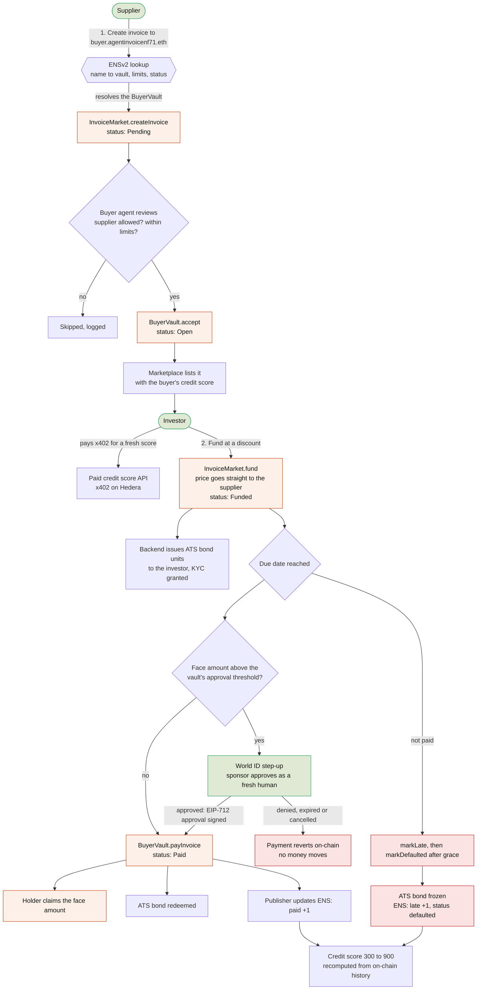
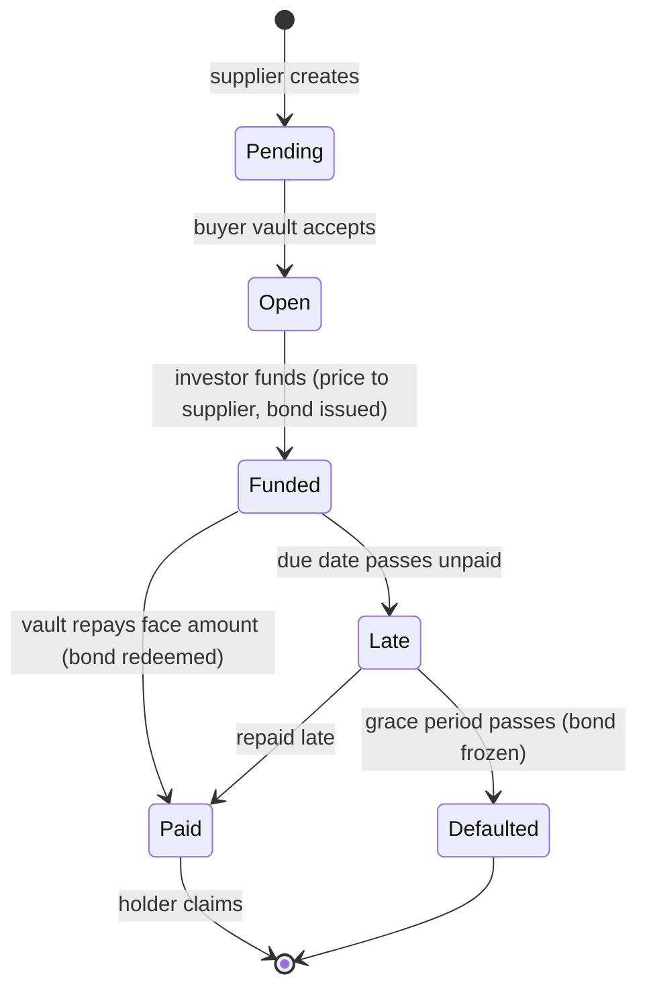
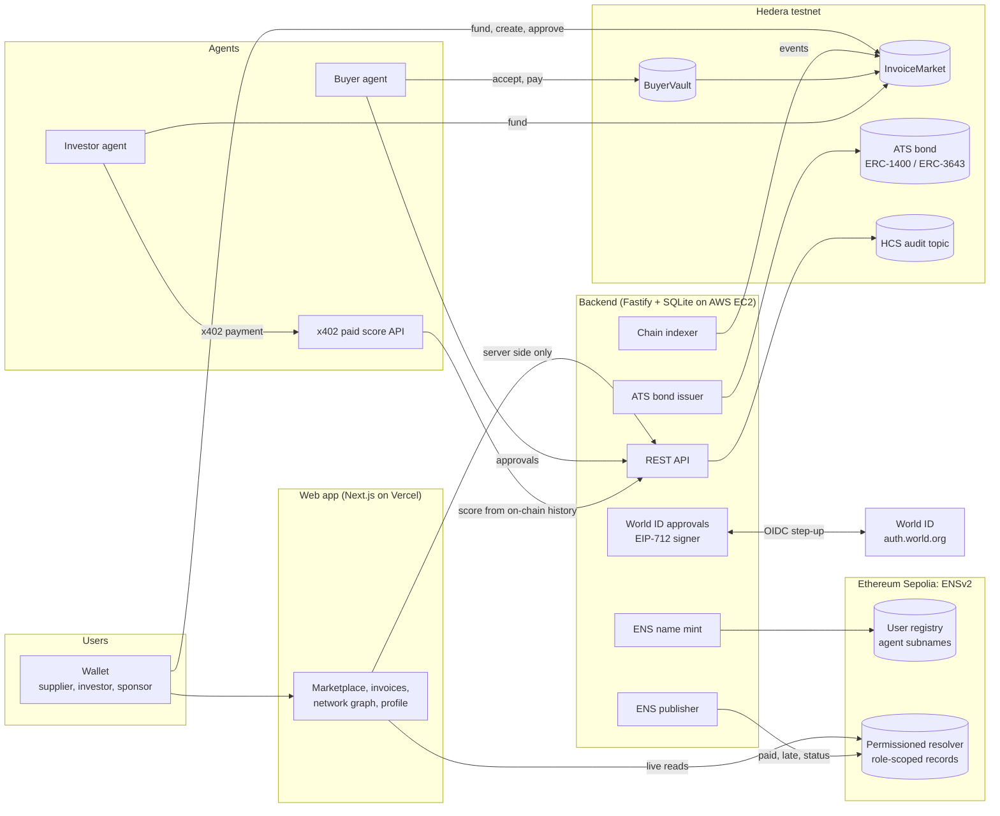
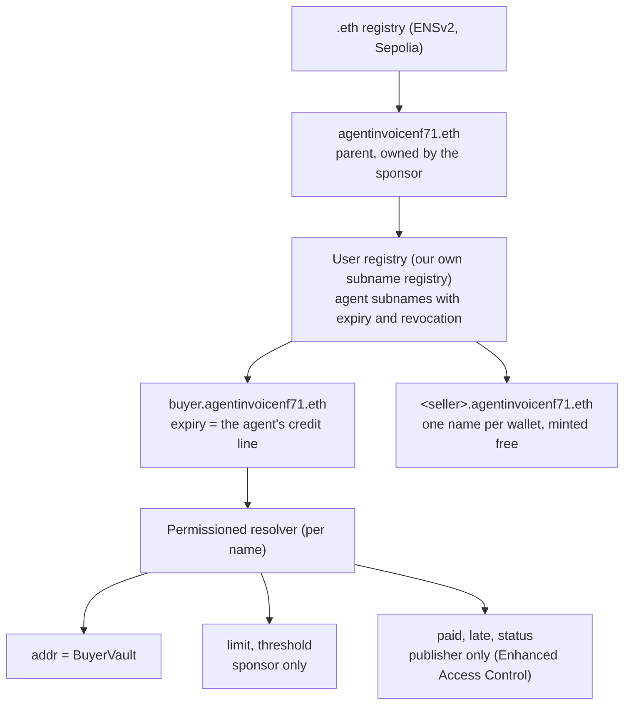
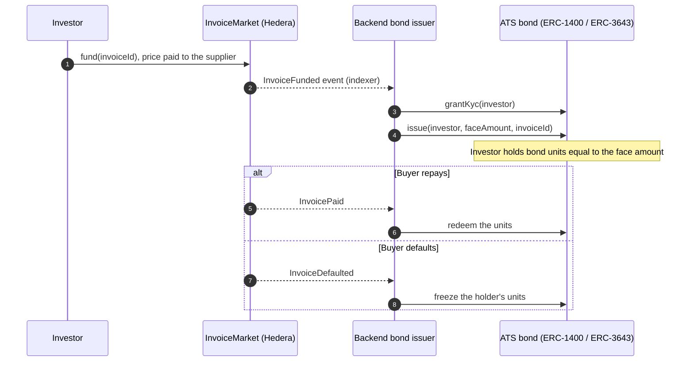
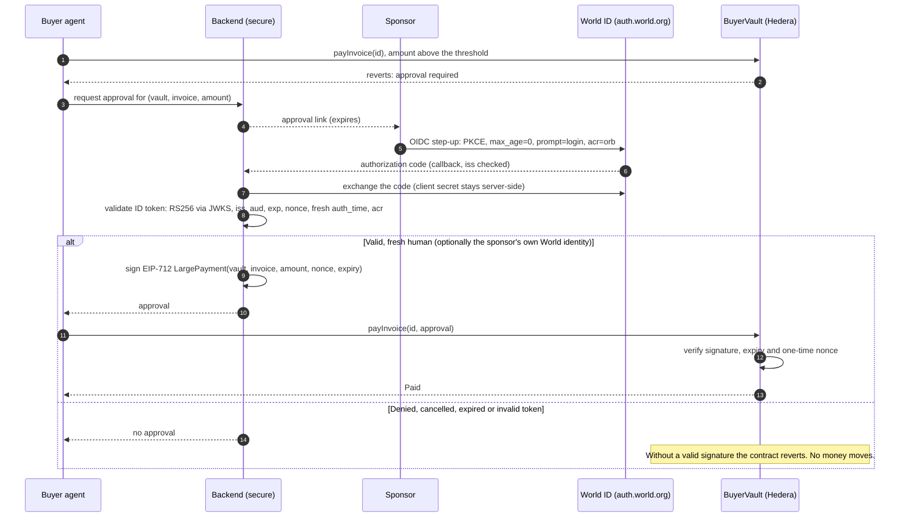

<div align="center">

# Invoice Agent

### Get paid today for invoices due next month.

**Invoice factoring for the agent economy.** AI buyer agents pay invoices from on-chain vaults, investors fund those invoices early for a fixed return, every agent is an **ENSv2** name with permissioned records, big payments need a **World ID** human approval, and every funded invoice becomes an **ATS bond** on **Hedera**.

**[Live demo](https://invoiceagent-ethglobal.vercel.app)** · [Demo agent on ENS](https://sepolia.app.ens.domains/buyer.agentinvoicenf71.eth) · [InvoiceMarket on HashScan](https://hashscan.io/testnet/contract/0xb41048c7369d33d4e396ccb2e95e974b95a06d8b) · [Demo script](docs/DEMO_SCRIPT.md)

`Hedera testnet` · `ENSv2 on Sepolia` · `World ID Agent Pass` · `Asset Tokenization Studio` · `x402` · `HCS`

</div>

---

## Contents

1. [The problem](#the-problem)
2. [What Invoice Agent does](#what-invoice-agent-does)
3. [Product flow](#product-flow)
4. [Architecture](#architecture)
5. [Sponsor tracks](#sponsor-tracks)
   - [Best Use of ENSv2](#-best-use-of-ensv2)
   - [Tokenize Anything with Hedera Studios (ATS)](#-tokenize-anything-with-hedera-studios)
   - [World ID Agent Pass](#-world-id-agent-pass)
6. [More under the hood](#more-under-the-hood)
7. [Deployed addresses](#deployed-addresses)
8. [Run it yourself](#run-it-yourself)
9. [Documentation](#documentation)
10. [Repository layout](#repository-layout)
11. [Status and honest notes](#status-and-honest-notes)
12. [Team](#team)

---

## The problem

Small suppliers wait 30 to 90 days to be paid. Factoring (selling an invoice early at a discount) fixes that, but it relies on trusting the buyer. Now buyers are increasingly **AI agents** that pay on someone's behalf. That raises three questions nobody answers today:

1. **Who is this agent, and who is responsible for it?** An agent needs a public identity with limits that its owner sets and nobody else can change.
2. **Will it pay?** Investors need a payment record they can verify without trusting a platform.
3. **What stops it doing something big on its own?** Large payments need a real human to approve them, at that moment.

## What Invoice Agent does

| Role | What they do | What they get |
|---|---|---|
| **Supplier** | Creates an invoice to a buyer agent, by its ENS name | Paid **today** by an investor, instead of in 30 days |
| **Investor** | Funds an invoice at a discount, after checking the buyer's credit score | A fixed return on the due date, and an **ATS bond** as proof of ownership |
| **Buyer agent** | Accepts valid invoices and repays on the due date, from its own on-chain vault, within limits | A public ENS identity and a credit score that grows with every on-time payment |
| **Sponsor (human)** | Owns the agent's ENS name, sets its limits, approves large payments with **World ID** | Accountability without micromanaging the agent |

Everything is enforced on-chain: the **BuyerVault** contract enforces daily limits, supplier allowlists and the human approval threshold. **ENSv2** holds the agent's identity, limits and record, with role-based write permissions. Every lifecycle step goes to the **Hedera Consensus Service** audit log.

---

## Product flow



### Invoice lifecycle (on-chain state machine)



---

## Architecture



---

## Sponsor tracks

### 🧬 Best Use of ENSv2

**Agents are namespaces.** Every buyer agent is a subname under our ENSv2 parent on Sepolia, and ENS is the single source of truth for who the agent is, what it may spend, and how it has behaved. The app reads it live, and the agent's limits exist nowhere else.



| ENSv2 feature | How Invoice Agent uses it |
|---|---|
| **Own subname registry** (User registry) | We deploy our own registry under `agentinvoicenf71.eth` and register each agent as a subname, plus one free name per seller wallet. |
| **Expiring subnames** | The subname's expiry is the agent's **credit line**. When it lapses, `readAgentFromEns` reports the agent as revoked and investors see it. |
| **Revocable subnames** | The sponsor can `unregister` a misbehaving agent (`scripts/ens/revoke.ts`), and it disappears from the network. |
| **Permissioned resolver** | Each agent name points at a permissioned resolver holding `addr` (its BuyerVault) and its text records, so the name owns its data. |
| **Enhanced Access Control** | The backend publisher is granted `ROLE_SET_TEXT` for **only** `paid`, `late` and `status`. It cannot touch `limit` or `threshold`, which only the sponsor can set. `scripts/ens/refusal.ts` proves the publisher's write to `limit` is refused on-chain. |
| **Agent identity and permissions** | Suppliers address invoices to `buyer.agentinvoicenf71.eth`, not a hex address. The app resolves the vault live, and every graph node links to the ENS app for verification. |

| Record | Set by | Meaning |
|---|---|---|
| `addr` | sponsor | the BuyerVault the agent pays from |
| text `limit` | sponsor | daily spending limit |
| text `threshold` | sponsor | payments above this need a World ID approval |
| text `paid` | publisher | invoices paid on time |
| text `late` | publisher | invoices paid late or defaulted |
| text `status` | publisher | `active`, `paused` or `defaulted` |
| expiry | registry | the credit line |

**Not hard-coded:** the create-invoice form, the agent page ("Live from ENS") and the network graph all read Sepolia live through viem. Verify it in the [ENS app](https://sepolia.app.ens.domains/buyer.agentinvoicenf71.eth) or with `bunx tsx --env-file=.env scripts/ens/check.ts`. Full notes: [docs/notes/ensv2.md](docs/notes/ensv2.md).

### 🪙 Tokenize Anything with Hedera Studios

**Fractional ownership of invoices, sold to investors.** That's the first idea on the track brief, and it's the core of the product. When an investor funds an invoice, the backend uses **Asset Tokenization Studio** to make the position a real security token on Hedera testnet.



| Requirement / extra | Where |
|---|---|
| Uses ATS to issue and manage a tokenized asset | `services/backend/src/bond/` (issue on Funded, redeem on Paid, freeze on Defaulted) with `@hashgraph/asset-tokenization-sdk`, and `scripts/ats/create-bond.ts` |
| Deployed and demoed on Hedera testnet | InvoiceMarket and BuyerVault on Hedera testnet ([addresses below](#deployed-addresses)); proof-of-ownership card on each invoice page |
| Lifecycle operations | Issuance, **redemption** on repayment, **freeze** on default |
| Compliance controls (extra) | **KYC** granted per investor before issuance; **freeze** on default; transfer restrictions enforced by the ATS token |
| Audit trail | Every lifecycle event is published to an **HCS** topic and shown on the invoice page |

Notes: [docs/notes/ats.md](docs/notes/ats.md) · bond setup: [docs/DEPLOY.md](docs/DEPLOY.md#3-create-the-ats-bond-once-by-hand).

### 🚀 World ID Agent Pass

**A meaningful action that needs a human:** an AI agent wants to pay an invoice above its sponsor's threshold. It can't, on-chain, until the sponsor proves at that moment that they are a real person, with a fresh World ID step-up.



| Requirement | How we meet it |
|---|---|
| Official World ID Agent Pass integration | OIDC step-up against `https://auth.world.org` (authorize, token, JWKS from discovery), PKCE S256 |
| Complete journey | Request (approval link) → sponsor completes World ID → backend validates → **the vault pays on-chain** |
| Unsuccessful path | Denied, cancelled, expired or invalid: no approval is signed, and `BuyerVault` **reverts** any payment above the threshold without one |
| Secure backend validation | Code exchange, ID-token signature and claims are checked server-side only; the client secret never reaches the browser; the approval is bound to one vault, invoice, amount, expiry and single-use nonce, and enforced by the contract |
| Integration debrief | [docs/FEEDBACK_WORLD.md](docs/FEEDBACK_WORLD.md) |

Test proofs use fake identities, so this is not production security. Notes: [docs/notes/world-agentpass.md](docs/notes/world-agentpass.md).

---

## More under the hood

- **On-chain credit score (300 to 900).** Deterministic and computed from on-chain invoice history across five weighted factors: payment history, defaults and recency, exposure vs limit, history length, and track record size. Each factor links to the invoices behind it. Buyers with fewer than 3 settled invoices show as `New`. ([notes](docs/notes/credit-score.md))
- **x402 paid data.** The investor agent pays per request for a fresh buyer score from our paid API, using the x402 `exact` scheme on Hedera through a public facilitator. ([notes](docs/notes/x402-hedera.md))
- **Autonomous agents.** The **buyer agent** accepts invoices within its vault rules and pays on time, serving every vault buyers register where it is the on-chain agent. The **investor agent** funds invoices that meet its score, discount and exposure rules.
- **Hedera Agent Accounts ready.** All agent spending goes through one `AgentAccount` interface (`packages/shared/src/agentAccount.ts`): BuyerVault today, Hedera Agent Accounts when their API is public. ([notes](docs/notes/agent-accounts.md))
- **HCS audit log.** Invoice created, accepted, funded, paid, late, approvals: each one is a message on a Hedera Consensus Service topic, shown as the activity feed on every invoice.
- **Network graph.** Who owes whom, who funded whom, and which human vouches for each agent. Click any party to verify it on ENS, Etherscan or HashScan.
- **Stablecoin settlement (in progress).** USDC settlement with HBAR→USDC swaps on SaucerSwap is built in [#58](https://github.com/nisargpatel7042lva/agentinvoice/pull/58) and waiting on a live swap test and a contract redeploy. ([notes](docs/notes/saucerswap.md))

---

## Deployed addresses

| What | Network | Address |
|---|---|---|
| InvoiceMarket | Hedera testnet (296) | [`0xb41048c7369d33d4e396ccb2e95e974b95a06d8b`](https://hashscan.io/testnet/contract/0xb41048c7369d33d4e396ccb2e95e974b95a06d8b) |
| BuyerVault (demo agent) | Hedera testnet (296) | [`0xbc792de2be972434a996f222da426b590e858056`](https://hashscan.io/testnet/contract/0xbc792de2be972434a996f222da426b590e858056) |
| Demo agent name | Sepolia, ENSv2 | [`buyer.agentinvoicenf71.eth`](https://sepolia.app.ens.domains/buyer.agentinvoicenf71.eth) |
| Permissioned resolver | Sepolia | `0xc5C8C0152EF689340430aE64Dc8243aBDC2e4DC7` |
| User registry (agent subnames) | Sepolia | `0x6EA8A3089761Bc14B7Aaa4caB41041f2670a342E` |
| Sponsor / approval verifier | both | `0x27a3c43158AC762F57B3aBe459a98e67659738EE` |

Source verification on HashScan (Sourcify): `cd contracts && forge verify-contract <address> src/InvoiceMarket.sol:InvoiceMarket --chain 296 --verifier sourcify`.

---

## Run it yourself

Requirements: Node 20+, Bun 1.3+, git and [Foundry](https://getfoundry.sh) (`forge` on your PATH).

```bash
git clone https://github.com/nisargpatel7042lva/agentinvoice.git
cd agentinvoice
bun install
bun run verify          # typecheck, lint, all TypeScript tests, contract tests
```

```bash
cp .env.example .env    # names only; fill in what you need, features stay off until configured
bun run dev:backend     # API, chain indexer, ENS publisher, approvals (http://localhost:3001/health)
bun run dev             # web app (http://localhost:3000)
```

Agents: `bun run --cwd agents/buyer-agent dev` and `bun run --cwd agents/investor-agent start` (`DRY_RUN=1` never sends a transaction). Contracts: `cd contracts && forge test`. Deploying the backend: [docs/DEPLOY.md](docs/DEPLOY.md), [docs/SELF_HOSTING.md](docs/SELF_HOSTING.md). Full testnet runbook: [docs/RUNBOOK-testnet.md](docs/RUNBOOK-testnet.md).

The backend checks `.env` at boot and lists any half-configured feature by variable name, never by value. Code that opens the database must run under Node (`tsx`, `vitest`), because `better-sqlite3` crashes under Bun 1.3.

---

## Documentation

Full map (submission vs design vs internal notes): **[docs/README.md](docs/README.md)**.

| Doc | For |
|---|---|
| [docs/DEMO_SCRIPT.md](docs/DEMO_SCRIPT.md) | Mentor / judge walkthrough (~5 minutes) |
| [docs/END_TO_END_CHECKLIST.md](docs/END_TO_END_CHECKLIST.md) | Merged vs live-verified, demo and hygiene checklist |
| [docs/DEPLOY.md](docs/DEPLOY.md) | Vercel + AWS + ATS bond setup |
| [docs/RUNBOOK-testnet.md](docs/RUNBOOK-testnet.md) | Local testnet transactions |
| [docs/SELF_HOSTING.md](docs/SELF_HOSTING.md) | Run your own buyer or investor agent |
| [docs/FEEDBACK_WORLD.md](docs/FEEDBACK_WORLD.md) | World ID prize debrief |
| [docs/notes/saucerswap.md](docs/notes/saucerswap.md) | HBAR→USDC treasury helpers |

---

## Repository layout

| Path | What it is |
|---|---|
| `apps/web` | Next.js app: landing, marketplace, create invoice, **USDC treasury**, network, agent, profile, approval |
| `services/backend` | Fastify + SQLite: API, chain indexer, ENS publisher and name mint, ATS bond issuer, World ID approvals, HCS audit |
| `services/paid-api` | x402 paid credit-score API on Hedera |
| `agents/buyer-agent` | Accepts and pays invoices from BuyerVaults within on-chain rules |
| `agents/investor-agent` | Funds invoices that meet its rules; pays x402 for scores |
| `packages/shared` | Types, schemas, ABIs, addresses, ENS reader, credit score, x402 client, AgentAccount adapter, SaucerSwap helpers |
| `contracts` | Foundry: `InvoiceMarket`, `BuyerVault`, `BuyerEscrow`, with security, fuzz and invariant tests |
| `scripts` | Deploy, ENS (register, grant, refusal, revoke, check), ATS bond, SaucerSwap CLI, end-to-end checks |
| `docs` | Index in [docs/README.md](docs/README.md): demo, deploy, runbooks, checklists, design, internal notes |

---

## Status and honest notes

- **Testnet only.** Hedera testnet and Ethereum Sepolia. Not financial advice; not production security.
- **World ID** test proofs use fake identities.
- **Hedera Agent Accounts** are not public yet; we run the same model on our own BuyerVault behind one interface.
- **Settlement is in HBAR today.** USDC settlement is built and tested ([#58](https://github.com/nisargpatel7042lva/agentinvoice/pull/58)) but not live yet.
- **Contributing:** `main` is protected. Open a pull request; CI (`verify-fast`) must pass. Never commit `.env` or keys: `.env.example` lists names only.

---

## Team

| | Focus |
|---|---|
| **Nisarg Patel** ([@nisargpatel7042lva](https://github.com/nisargpatel7042lva)) | Product, web app and design, agents and integration |
| **Siddharth Panchal** ([@siddharth-09](https://github.com/siddharth-09)) | Backend, ENSv2, World ID approvals, ATS bonds, deployment |
| **Mann Shah** ([@mannshah24](https://github.com/mannshah24)) | Smart contracts, x402 paid API, escrow, Agent Accounts |
| **Dhruv** ([@Dhruv26052005](https://github.com/Dhruv26052005)) | On-chain credit score |
| **Rishita** ([@Pixie-19](https://github.com/Pixie-19)) | Buyer agent, SaucerSwap HBAR→USDC |

Built at ETHGlobal.
