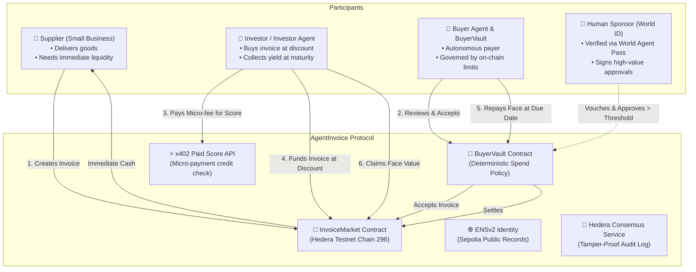
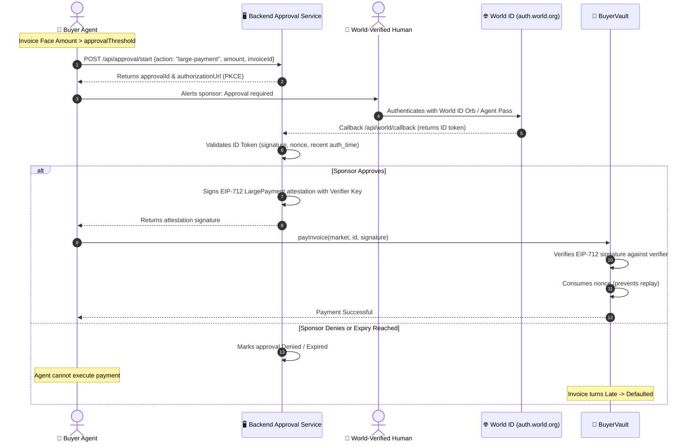

# AgentInvoice: Master Project Architecture, Workflow & Presentation Guide

---

## 1. Executive Summary & Problem Statement

### The Problem: B2B Liquidity Bottlenecks & The Rise of AI Buyers
In traditional commerce, invoice financing (factoring) is a multi-trillion-dollar industry. Small businesses deliver goods or services today but typically wait 30, 60, or 90 days for corporate payment terms. This creates severe working-capital stress.

As AI agents emerge as autonomous economic actors—renting compute, hiring human contractors, licensing APIs, and ordering enterprise supplies—a new frontier appears:
1. **How does a small business trust an AI agent to pay later?**
2. **How does a supplier get paid immediately on day zero?**
3. **How do investors safely front capital when the debtor is software?**

### The AgentInvoice Solution
**AgentInvoice** introduces **trust-minimized invoice financing where the debtor is an AI agent governed by on-chain rules and backed by a World-verified human sponsor**.

* **For Suppliers**: Mint an invoice owed by a buyer agent and receive immediate discounted cash from investors on Day 0.
* **For Investors**: Purchase invoices at a discount (e.g., pay 95 HBAR for a 100 HBAR invoice), evaluate risk via a paid credit-score API (HTTP 402), and collect the full face value upon maturity.
* **For Buyer Agents**: Maintain on-chain spending vaults (`BuyerVault`) with pre-set daily budgets, merchant allowlists, and automated maturity payments.
* **For Human Sponsors**: Provide cryptographic accountability. A World ID-verified human sponsor vouches for the agent and acts as the gatekeeper for transactions exceeding safety thresholds.

---

## 2. Core Actors & Roles



1. **The Supplier (Business)**: Delivers goods/services, submits an invoice specifying face amount, price (discount), due date, and an `evidenceHash` (SHA-256 fingerprint of private delivery proof).
2. **The Buyer Agent (`BuyerVault`)**: An autonomous agent operating a smart vault. The vault holds capital, enforces strict daily spending limits, and only allows accepted vendors.
3. **The Investor (Human or AI Agent)**: Fronts the capital to the supplier today. The Investor Agent uses an LLM and an on-chain credit score to decide whether to purchase.
4. **The Human Sponsor (World ID)**: An Orb-verified human who stakes identity reputation. High-value payments ($> \text{approvalThreshold}$) or untrusted supplier onboarding requires step-up World ID authentication.

---

## 3. End-to-End System Workflows

### Flow 1: Invoice Lifecycle (Happy Path)

```mermaid
sequenceDiagram
    autonumber
    actor Supplier as 🏢 Supplier
    actor BuyerAgent as 🤖 Buyer Agent
    participant Vault as 🏦 BuyerVault
    participant Market as 📄 InvoiceMarket
    actor Investor as 💼 Investor Agent
    participant PaidAPI as ⚡ x402 Score API
    participant ENS as 🌐 ENSv2 (Sepolia)
    participant HCS as 📜 Hedera HCS

    Supplier->>Market: createInvoice(buyerVault, face, price, due, evidenceHash)
    Note over Market: Status = Pending (Cannot be funded yet)
    
    BuyerAgent->>Vault: accept(market, id)
    Vault->>Vault: Check allowlist & supplier limit
    Vault->>Market: acceptInvoice(id)
    Note over Market: Status = Open (Ready for funding)
    
    Investor->>PaidAPI: GET /score?vault=0x...
    Note over PaidAPI: Answers HTTP 402 Payment Required
    Investor->>PaidAPI: Pays x402 fee in HBAR via TransferTransaction
    PaidAPI-->>Investor: Returns Band A (95%+ on-time rate)
    
    Investor->>Market: buy(id) [Sends discounted price]
    Market->>Supplier: Transfers discount price immediately!
    Note over Market: Status = Funded; ATS Bond units issued
    Market-->>HCS: Log InvoiceFunded event
    
    Note over BuyerAgent,Vault: Time passes until Due Date
    
    BuyerAgent->>Vault: payInvoice(market, id, approval)
    Vault->>Vault: Checks dailyLimit & balance
    Vault->>Market: payInvoice{value: faceAmount}(id)
    Note over Market: Status = Paid; claimable[investor] += faceAmount
    Market-->>ENS: Publisher increments 'paid' count
    Market-->>HCS: Log InvoicePaid event
    
    Investor->>Market: claim()
    Market->>Investor: Transfers full face value (Profit realized!)
```

### Flow 2: Human-in-the-Loop Risk Gating (World ID Step-Up)



### Flow 3: Default & Insolvency Enforcement
1. If the buyer agent fails to settle before the `dueDate`, any network participant can call `InvoiceMarket.markLate(id)`.
2. After the `gracePeriod` expires without payment, any actor can call `InvoiceMarket.markDefaulted(id)`.
3. **Consequences of Default**:
   - Status transitions to `Defaulted`.
   - The backend publisher updates the buyer's public ENS record `agentinvoice.status = defaulted`.
   - The buyer's ENS credit-line subname is revoked (`scripts/ens/revoke.ts`).
   - The defaulting party is frozen in the ATS token registry.
   - Investor loss is publicly transparent, permanently degrading the buyer's future risk band to **Band C**.

---

## 4. Hackathon Prize Track Architecture

AgentInvoice explicitly addresses the requirements of **4 major prize tracks**:

```
┌────────────────────────────────────────────────────────────────────────────────────────┐
│                                 AgentInvoice Architecture                              │
├──────────────────────────┬──────────────────────────┬──────────────────────────────────┤
│ 1. Hedera Tokenize       │ 2. Hedera x402           │ 3. World ID Agent Pass           │
│ • ATS Zero-Coupon Bond   │ • Express paid-api (402) │ • Step-Up OIDC PKCE              │
│ • ERC-1400 / ERC-3643    │ • Client payment helper  │ • Sponsor Attestation            │
│ • KYC / Freeze controls  │ • HCS Audit Trail topic  │ • EIP-712 Signature (LargePayment│
├──────────────────────────┴──────────────────────────┴──────────────────────────────────┤
│ 4. ENSv2 Namespaces (Ethereum Sepolia)                                                 │
│ • Subnames: buyer.agentinvoice.eth resolving to BuyerVault                             │
│ • Enhanced Access Control: Sponsor sets limits; Publisher sets metrics                 │
│ • Transparent on-chain credit records (limit, threshold, paid, late, status)           │
└────────────────────────────────────────────────────────────────────────────────────────┘
```

### Track 1: Hedera Tokenize ($5,000)
* **Real Real-World Asset (RWA) Mechanism**: Invoices represent discounted zero-coupon debt obligations.
* **Implementation**: Issued via Asset Tokenization Studio (ATS) bond standard (ERC-1400 compliance) or fallback Stablecoin Studio.
* **On-Chain Evidence**: Token issuance on funding, investor KYC whitelist registration, transfer restrictions, and automated redemption at maturity.

### Track 2: Hedera AI Agents That Pay / x402 ($6,500)
* **Protocol**: Built on standard `x402` HTTP 402 Payment Required protocol on Hedera testnet.
* **API Service**: `services/paid-api` serves `GET /score?vault=0x...`.
* **Autonomous Payment**: The Investor Agent makes programmatic micro-payments in HBAR with **zero human confirmation**.
* **Extra Points Features**:
  - **Spending Controls**: `payAndGet()` enforces client-side `dailyBudget`, `perCallCap`, and domain allowlists.
  - **HCS Audit Topic**: Every payment, approval, and agent decision is broadcast to a Hedera Consensus Service topic for immutable public auditability (`GET /api/audit`).

### Track 3: World ID Agent Pass ($5,000)
* **Step-Up Verification**: Uses `auth.world.org` OpenID Connect with PKCE (RFC 7636 / RFC 9470).
* **Cryptographic Attestation**: The backend validates human uniqueness and signs an EIP-712 `LargePayment` or `SupplierApproval` attestation using the trusted verifier private key.
* **Negative Paths Covered**: Expired approvals, tampered nonces, wrong agent target, and human cancellation reject the action and protect the vault funds.

### Track 4: Best Use of ENSv2 ($7,000)
* **Agents as Namespaces**: Each buyer agent is assigned an ENS subname (e.g., `acme-buyer.agentinvoicenf71.eth`) resolving to its `BuyerVault` address.
* **Enhanced Access Control**:
  - **Sponsor Role**: Has exclusive write permissions for `limit` and `threshold`.
  - **Publisher Role**: Can only write operational state (`paid`, `late`, `status`).
* **Expiring Credit Line**: The subname itself has an on-chain expiry date (`expiresAt`). If the sponsor does not renew or if default occurs, the subname is revoked.

---

## 5. Team Division & Ownership Matrix

| Member | Domain & Workspaces | Key Deliverables | Done When |
| :--- | :--- | :--- | :--- |
| **Nisarg** (Lead) | `apps/web/`, `packages/shared/`, root CI, docs | Next.js App Router UI, Design System, Tailwind theme, Wallet Connect, Final Pitch Video | A stranger can execute the full demo from the README |
| **Mann** | `contracts/`, `services/paid-api/` | `InvoiceMarket.sol`, `BuyerVault.sol`, Foundry unit/fuzz tests, ATS bond scripts, x402 paid score service | Contract test coverage $>90\%$, paid API passes on testnet |
| **Siddharth** | `services/backend/` | Fastify backend, mirror node event indexer, World ID step-up OIDC, ENS publisher & EAC, HCS audit topic | Live ENS sync within 60s, World approvals verify on-chain |
| **Rishita** | `agents/`, `scripts/` | Autonomous Buyer Agent loop, Investor Agent loop, demo scripts (`scripts/lifecycle.ts`, `demo-ready.ts`) | Both agents autonomously execute buy and pay on testnet |
| **Dhruv** (5th Member - QA Lead) | Whole Repository, `scripts/e2e.ts`, Invariant Testing | E1–E10 test suite, adversarial testing, secret scans, Gate 0–5 validation, demo rehearsal | E1–E10 pass twice consecutively on testnet; zero leaks |

---

## 6. The Master Tester Blueprint (Scenarios E1 to E10)

The QA Lead enforces the project scoreboard using `scripts/e2e.ts`:

```
┌─────┬──────────────────────────┬────────────────────────────────────────────────────────┐
│ ID  │ Scenario                 │ Expected Result                                        │
├─────┼──────────────────────────┼────────────────────────────────────────────────────────┤
│ E1  │ Happy Path (Full Loop)   │ Supplier paid discount, Investor claims face, ENS + 1  │
├─────┼──────────────────────────┼────────────────────────────────────────────────────────┤
│ E2  │ Large Payment Approved   │ World step-up succeeds, EIP-712 consumed, Vault pays   │
├─────┼──────────────────────────┼────────────────────────────────────────────────────────┤
│ E3  │ Large Payment Denied     │ Sponsor cancels step-up, Vault skips, Default on ENS   │
├─────┼──────────────────────────┼────────────────────────────────────────────────────────┤
│ E4  │ Expired Approval         │ Stale authentication / timestamp rejected by contract  │
├─────┼──────────────────────────┼────────────────────────────────────────────────────────┤
│ E5  │ Nonce Replay Attack      │ Submitting already-used EIP-712 nonce reverts          │
├─────┼──────────────────────────┼────────────────────────────────────────────────────────┤
│ E6  │ Attestation Mismatch     │ Tampering invoiceId or amount fails signature check    │
├─────┼──────────────────────────┼────────────────────────────────────────────────────────┤
│ E7  │ Daily Limit Hard Cap     │ Daily spend exceeds limit -> reverts even if approved  │
├─────┼──────────────────────────┼────────────────────────────────────────────────────────┤
│ E8  │ ENS Role Denial (EAC)    │ Publisher trying to edit 'limit' reverts on-chain      │
├─────┼──────────────────────────┼────────────────────────────────────────────────────────┤
│ E9  │ Fake Invoice Protection  │ Unlisted supplier or over-limit invoice fails accept() │
├─────┼──────────────────────────┼────────────────────────────────────────────────────────┤
│ E10 │ Auditability & HashScan  │ Zero private keys in logs; all events link to HashScan │
└─────┴──────────────────────────┴────────────────────────────────────────────────────────┘
```

### Invariant Checks (Mathematical Safety)
1. **Solvency**: $\sum \text{Paid Out} + \sum \text{Claimable} \le \sum \text{Contract Inflows}$
2. **State Monotonicity**: Status moves strictly: $\text{Pending} \to \text{Open} \to \text{Funded} \to \text{Paid}$ (or $\text{Late} \to \text{Defaulted}$).
3. **No Trapped Funds**: Reentrancy-guarded pull payments (`claim()`) ensure funds are never locked.

---

## 7. The 3-Minute Presentation & Demo Pitch Script

### Stage 1: The Hook & The Problem (0:00 – 0:30)
> *"Judges, small businesses wait 60 to 90 days to get paid. Invoice financing solves this by letting investors buy receivables at a discount. But as AI agents become autonomous buyers—hiring contractors, renting servers, and purchasing enterprise services—how can a supplier trust an algorithm with 60-day terms? Today, we introduce **AgentInvoice**: invoice financing for the agentic economy, where buyers are autonomous agents with on-chain spending vaults, backed by World ID-verified human accountability."*

### Stage 2: Supplier Creation & Buyer Acceptance (0:30 – 1:15)
* **Screen**: Web UI $\to$ *Create Invoice* (`/supplier`).
* **Narrative**:
  > *"Here, our supplier creates an invoice for **100 HBAR** due in 3 minutes, offered at a 5% discount (95 HBAR). The debtor is specified as `buyer.agentinvoice.eth`.
  > Notice the status: **Pending**. Unlike vulnerable systems where anyone can invoice any victim, our buyer agent's vault enforces an on-chain allowlist. The buyer agent inspects the evidence hash and calls `accept()`. Now the invoice is **Open**."*

### Stage 3: x402 Credit Score & Investor Purchase (1:15 – 2:00)
* **Screen**: Web UI $\to$ *Marketplace* (`/`) & Investor Agent Terminal.
* **Narrative**:
  > *"Our autonomous Investor Agent discovers the open invoice. Before deploying capital, it queries our **Hedera x402 credit scoring API**. Notice the agent pays the HTTP 402 micro-fee autonomously in HBAR without any human intervention.
  > Seeing a **Band A rating** and checking the buyer's live ENS limits on Sepolia, the investor buys the invoice. The supplier immediately receives 95 HBAR in their wallet, and an **ATS bond** is issued to the investor."*

### Stage 4: Maturity Settlement & Claim (2:00 – 2:40)
* **Screen**: Web UI $\to$ *Invoice Detail* (`/invoice/[id]`).
* **Narrative**:
  > *"Fast forward to the due date. The buyer agent triggers settlement from its `BuyerVault`. Because the payment is within the daily limit and under the approval threshold, the contract transfers 100 HBAR to the market without human delay.
  > The investor clicks **Claim**, collecting the full 100 HBAR face value and locking in their yield. On Sepolia, the buyer's ENS `paid` record increments by one, and the entire audit trail is recorded to Hedera Consensus Service."*

### Stage 5: High-Value Human Gating & Default Path (2:40 – 3:20)
* **Screen**: Web UI $\to$ *Approval Portal* (`/approval/[id]`).
* **Narrative**:
  > *"What happens when an invoice exceeds the agent's safe spending threshold? The agent cannot execute it alone. It triggers a **World ID Agent Pass step-up verification**. The human sponsor receives a push challenge, authenticates with their World ID Orb proof, and signs an EIP-712 approval.
  > If the sponsor denies or cancels, the transaction halts. If the invoice expires, anyone can trigger `markLate` and `markDefaulted`. The defaulting buyer's ENS credit line is instantly revoked on Sepolia, and their bond account is frozen."*

### Stage 6: The Close (3:20 – 3:30)
> *"AgentInvoice brings institutional-grade working capital to autonomous commerce. Verified by World ID, settled on Hedera, and recorded on ENS. Thank you."*

---

## 8. Judge Q&A Cheat Sheet

| Question | Honest & Bulletproof Answer |
| :--- | :--- |
| **"Why is blockchain necessary? Why not a standard database?"** | Traditional factoring requires extensive legal contracts because companies can hide liabilities. With AgentInvoice, the debtor's balance, daily spending limit, merchant allowlist, and payment history are verifiably locked on-chain in `BuyerVault` and publicly queryable via ENS. |
| **"What if the AI agent hallucinates or goes rogue?"** | The LLM does not hold private keys and cannot sign payments. It operates strictly within deterministic on-chain smart contract guardrails: hard daily limits, strict merchant allowlists, and mandatory World ID step-up approval for any transaction above the safety threshold. |
| **"How does this differ from previous invoice tokenization projects?"** | Earlier projects (like Finvoice) tokenized traditional human invoices. AgentInvoice solves the specific problem of **AI agents as the payers**, combining autonomous x402 credit-score micro-fees, ENSv2 permissioned namespaces for agent credit lines, and World ID human-in-the-loop step-up security. |
| **"Is this invoice token a security?"** | In this hackathon testnet prototype, invoices are treated as zero-coupon commercial paper issued between allowlisted demo parties to model protocol mechanics. Production deployment would require jurisdiction-specific factoring legal agreements and regulatory compliance via ATS/ERC-3643 identity claims. |
| **"What does World ID actually prove?"** | World ID proves that the sponsor is a verified, unique human being (Sybil-resistant). Our backend binds that human verification to a single, cryptographic EIP-712 signature for one specific action, vault, invoice, and expiration time. |

